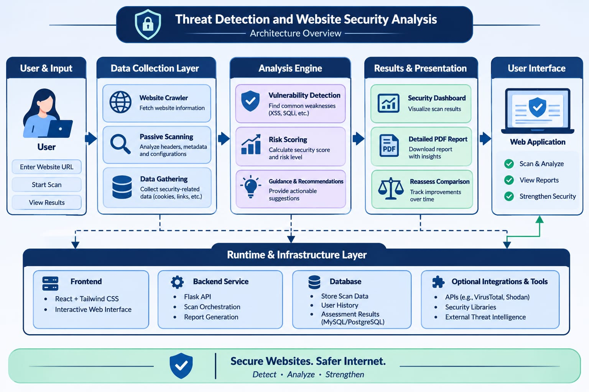
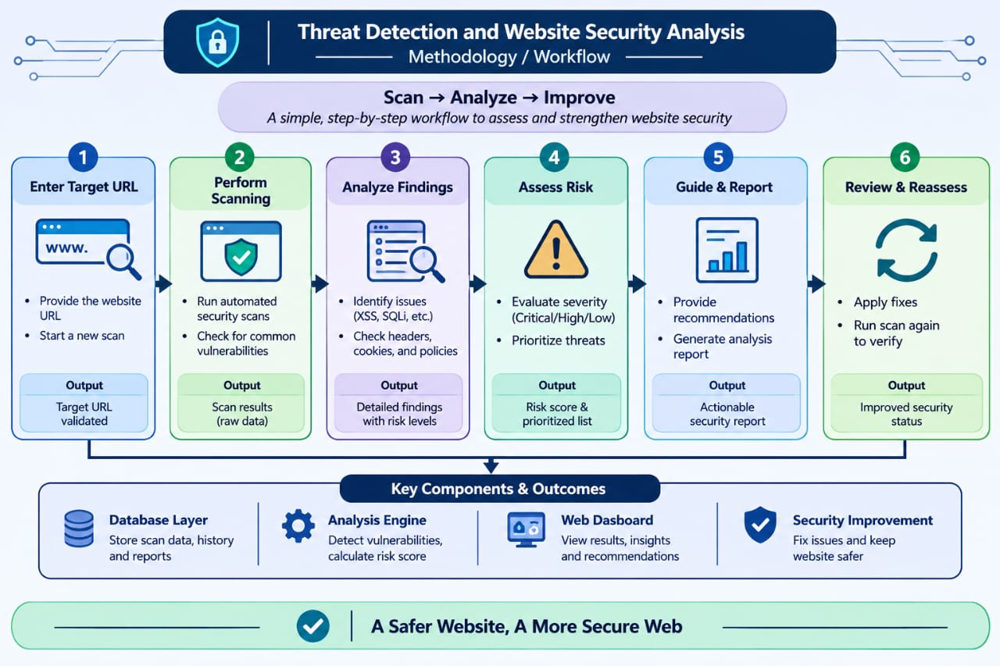

# ThreatGuard - Threat Detection & Security Analysis System

A web app that scans websites for security vulnerabilities and privacy issues. Built with React frontend, Flask backend, and SQLite database.

## Project Structure

```
├── backend/              # Flask API server
│   ├── app.py            # API routes
│   ├── run.py            # start the server
│   └── requirements.txt  # python dependencies
│
├── frontend-react/       # React app (Vite)
│   ├── src/pages/        # all the pages (dashboard, scan, results, etc)
│   ├── src/App.jsx       # main layout with sidebar
│   ├── src/api.js        # API calls to backend
│   └── package.json
│
├── threatguard/           # python scanning modules
│   ├── database/          # SQLAlchemy models
│   ├── modules/           # scanner, privacy analyzer, scoring, etc
│   └── utils/             # helpers and validators
│
├── database/              # MySQL schema (reference)
│   ├── schema.sql
│   ├── seed.sql
│   └── queries.sql
│
└── docker-compose.yml
```

## Architecture

The diagram below presents the system architecture. Some pictured items—such as
XSS/SQL injection testing, external threat-intelligence APIs, Tailwind CSS, and
MySQL/PostgreSQL runtime support—are conceptual and are not part of the current
implementation. ThreatGuard currently performs passive website checks, uses
React + Vite, Flask, and SQLAlchemy with SQLite by default.



## Methodology / Workflow

The illustration below presents a conceptual end-to-end workflow. Some shown
capabilities, including XSS/SQLi detection and automatically applying fixes,
are not implemented in the current ThreatGuard scanner. The implemented flow
uses authorized, passive checks and provides guidance for owners to apply fixes.



## How to Run

**Backend:**
```
pip install -r backend/requirements.txt
python backend/run.py
```
Server starts at http://localhost:5000

**Frontend:**
```
cd frontend-react
npm install
npm run dev
```
Opens at http://localhost:3000

Both need to be running at the same time. The frontend automatically sends API requests to the backend through the Vite proxy.

## What it Does

- Scans any public website URL
- Checks HTTPS, TLS certificates, security headers (CSP, HSTS, etc)
- Checks cookie security flags (Secure, HttpOnly, SameSite)
- Detects third-party trackers and analytics scripts
- Checks if the site has a privacy policy
- Gives a Trust Score out of 100
- Can generate PDF reports
- Compare old and new scans to track improvements

## API Endpoints

| Method | URL | What it does |
|--------|-----|-------------|
| POST | /api/scan | scan a website |
| GET | /api/scans | list all scans |
| GET | /api/scans/:id | get scan details |
| GET | /api/dashboard | dashboard stats |
| GET | /api/scans/:id/findings | get findings |
| POST | /api/scans/:id/report | generate PDF |
| POST | /api/reassess | compare two scans |
| GET | /api/history | scan history |

## Database

Uses SQLite with SQLAlchemy ORM. Tables: users, websites, scans, findings, reports.
Database file gets created automatically when you first run the backend.

MySQL reference schema is in the `database/` folder.

## Tech Stack

- **Frontend:** React, Vite, React Router, Recharts, Axios
- **Backend:** Flask, Flask-CORS
- **Database:** SQLite + SQLAlchemy
- **Scanning:** requests, BeautifulSoup, ssl module
- **Reports:** ReportLab
- **AI:** Groq API (optional - for explaining findings)

## Local before-and-after demo (development only)

This demo runs a deliberately simple site on `127.0.0.1:8765`. At first it
omits the Content-Security-Policy (CSP) header. ThreatGuard's normal protections
continue to block local/private targets. The backend permits only this exact
loopback demo origin when both `APP_ENV=development` and
`THREATGUARD_LOCAL_DEMO=1` are set. Do not enable this option in production.

### 1. Start the demo website

Open PowerShell at the repository root:

```powershell
$env:DEMO_ADD_CSP = "0"
py .\demo-site\server.py
```

Leave this window running. Open `http://127.0.0.1:8765` in a browser to see the
demo page. The server listens on loopback only; it is not exposed to your LAN.

### 2. Start the backend with the demo-only opt-in

Open a second PowerShell window at the repository root. This command assumes
the virtual environment is in the parent project folder. If yours is elsewhere,
use that Python executable instead.

```powershell
$env:APP_ENV = "development"
$env:THREATGUARD_LOCAL_DEMO = "1"
$env:PORT = "5055"
..\.venv\Scripts\python.exe backend\run.py
```

Leave this window running. Open a third PowerShell window and start the frontend:

```powershell
npm run dev --prefix frontend-react
```

### 3. Run the first scan

Open `http://localhost:3000`, sign in, and open **Scan Website**. Enter
`http://127.0.0.1:8765`, tick the authorization checkbox, and start the scan.
The report should include **Missing Content-Security-Policy Header**.

### 4. Apply the fix, then scan again

Stop only the demo server with **Ctrl+C** in its window. Restart it with CSP
enabled:

```powershell
$env:DEMO_ADD_CSP = "1"
py .\demo-site\server.py
```

In ThreatGuard, scan `http://127.0.0.1:8765` again, confirming authorization.
The second report should show the CSP header present and updated scores. Open
**Reassessment** to compare the two completed scans.

### Screenshots for your presentation

After running the demo, capture (1) the first report with the missing CSP
finding, (2) the second report after the fix, and (3) the reassessment view.
Save the images under `docs/screenshots/` and add them to the README before
presenting. Use screenshots of your actual runs, not example or fabricated
results.

### Safety limits

- The local exception requires development mode and the explicit opt-in.
- Only `http://127.0.0.1:8765` is allowed; other local/private targets remain
  blocked, including redirect destinations.
- The demo server binds to `127.0.0.1` and the scanner makes read-only GETs.

## Environment Variables

Create a `.env` file in backend/ (optional):
```
GROQ_API_KEY=your_key_here
```

## Team

| Name | Work |
|------|------|
| Vaishnavi | Frontend (React) + Backend API |
| Aishwarya | Database Schema |
| Aditi | Backend Modules |
