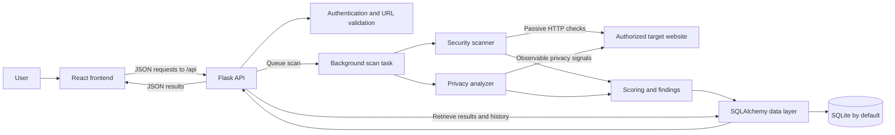

# ThreatGuard Backend API

## Overview

ThreatGuard uses a Flask backend to accept authorized website assessments, run passive security and privacy checks, store results, and compare assessments.

## Architecture

The frontend communicates with the Flask API using JSON requests. The backend validates requests, runs scans, and stores assessment results through SQLAlchemy. The frontend does not connect directly to the database.



**Scan flow:** The API queues an assessment, the background task runs the security and privacy checks, and the results are stored in the database. The frontend retrieves the results from the API.


## Setup and startup

From the project root, install the backend dependencies:

```powershell
py -m pip install -r backend\requirements.txt
py backend\run.py
```

The server prints the address and port it is using. The default is `http://127.0.0.1:5000`. If that port is unavailable, set a different port before starting the server:

```powershell
$env:PORT = "5055"
py backend\run.py
```

## Authentication

`GET /api/health`, `POST /api/auth/register`, and `POST /api/auth/login` do not require a token. Other API routes require the bearer token returned by login.

Add this header to protected requests:

```text
Authorization: Bearer <access_token>
```

## API endpoints

| Method | Endpoint | Purpose |
|---|---|---|
| GET | `/api/health` | Check whether the API is running |
| POST | `/api/auth/register` | Create an account |
| POST | `/api/auth/login` | Sign in and get an access token |
| GET | `/api/auth/me` | Get the signed-in account |
| POST | `/api/scan` | Queue an authorized website assessment |
| GET | `/api/scans` | List recent completed assessments |
| GET | `/api/scans/<scan_id>` | Get an assessment, its scores, and findings |
| GET | `/api/scans/<scan_id>/findings` | Get findings for an assessment |
| POST | `/api/reassess` | List scans for a URL or compare two scans |
| GET | `/api/history` | View assessment history |
| GET | `/api/scans/<scan_id>/report/download` | Download a generated report |

## Example: check API health

Request:

```http
GET /api/health
```

Example response:

```json
{
  "status": "ok",
  "version": "1.0.0"
}
```

## Example: start an assessment

Send this request to a website you own or have permission to assess. Include the bearer token in the request header.

```http
POST /api/scan
Content-Type: application/json
Authorization: Bearer <access_token>
```

Request body:

```json
{
  "url": "https://example.com",
  "authorized": true
}
```

A successful request returns a scan ID and a `queued` status. The assessment runs in the background. Use `GET /api/scans/<scan_id>` to check its status and retrieve the results.

## Example: reassess

To compare two completed scans, send both scan IDs:

```http
POST /api/reassess
Content-Type: application/json
Authorization: Bearer <access_token>
```

```json
{
  "scan_id_1": 1,
  "scan_id_2": 2
}
```

The response reports resolved, new, and remaining findings, along with score changes.

## Scan safety

Only assess websites you own or have permission to test. The backend validates submitted URLs and blocks local or private network targets by default. A local demo target is allowed only when the development demo option is explicitly enabled. Checks are passive and do not attempt to exploit vulnerabilities.